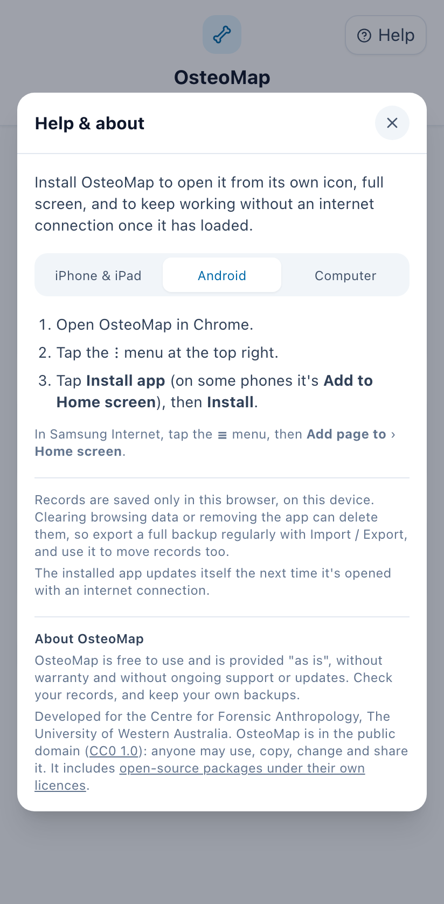
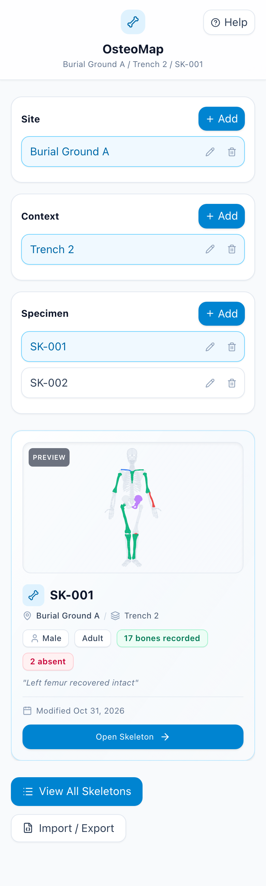
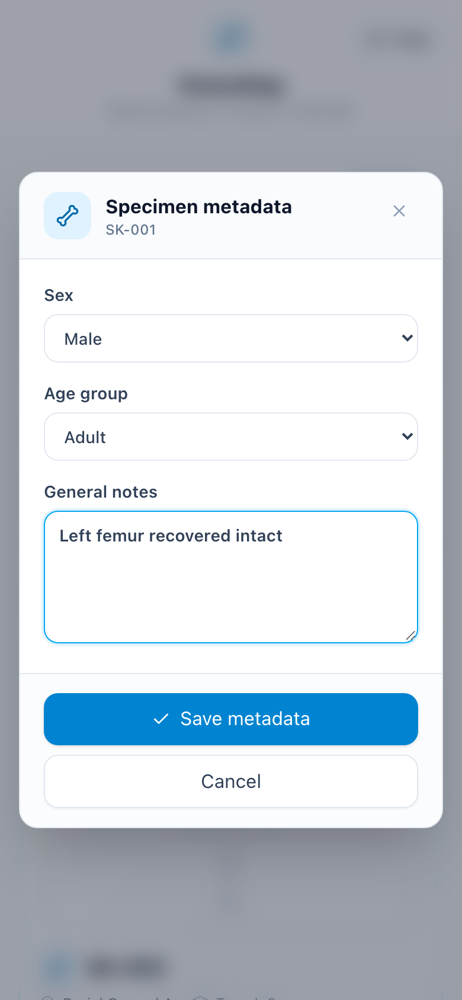
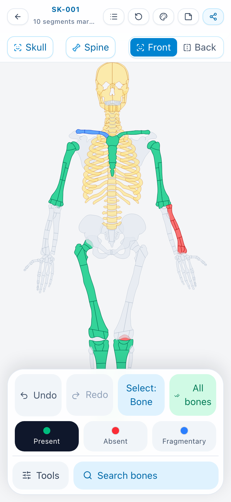
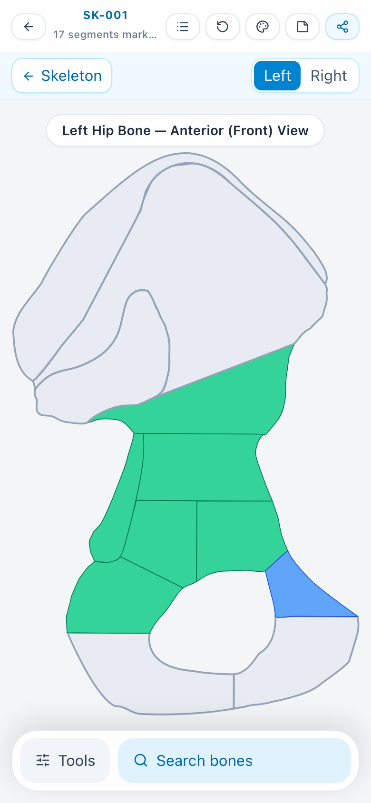
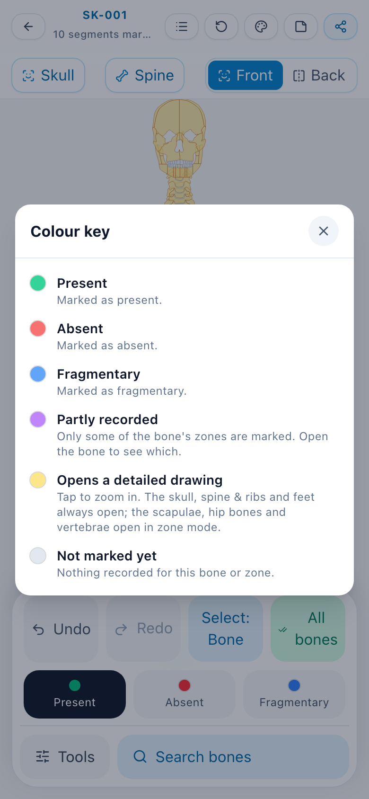
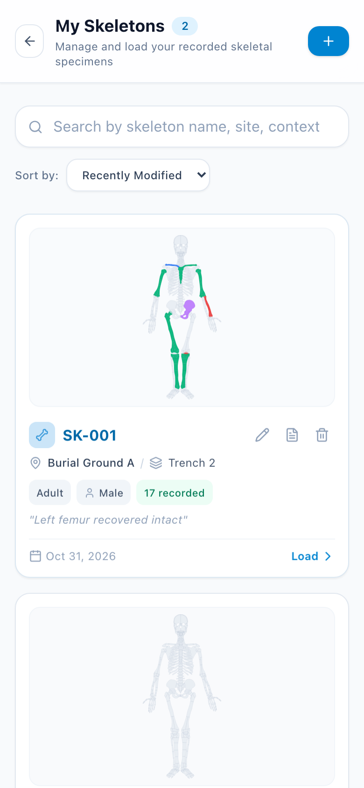
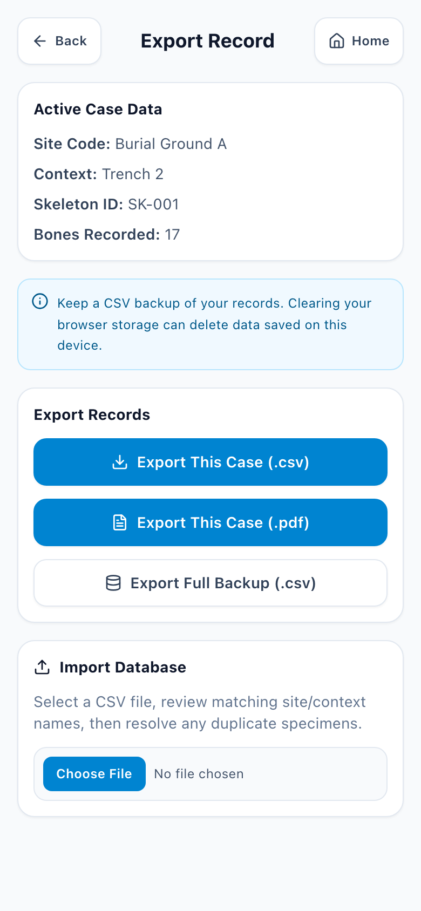
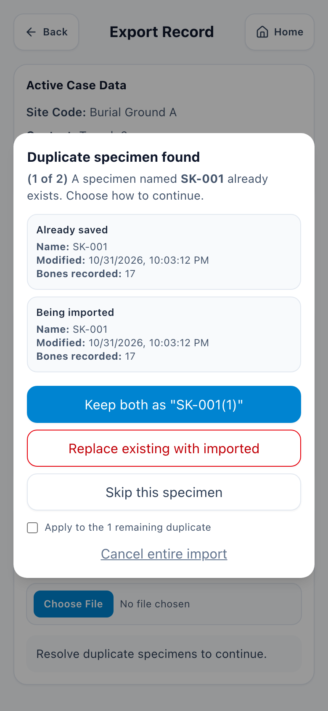

# OsteoMap User Guide

OsteoMap is a web app for recording skeletal inventories. You organise records by site, context and specimen, then mark each bone, or each zone of a bone, as present, absent or fragmentary on an interactive skeleton diagram. You can export your records as CSV and PDF files, and back them up and restore them with CSV files.

This guide covers OsteoMap 1.0.

## Contents

1. [Before you start: where your records are kept](#1-before-you-start-where-your-records-are-kept)
2. [Opening and installing OsteoMap](#2-opening-and-installing-osteomap)
3. [Sites, contexts and specimens](#3-sites-contexts-and-specimens)
4. [Recording skeletal findings](#4-recording-skeletal-findings)
5. [Colour key](#5-colour-key)
6. [My Skeletons](#6-my-skeletons)
7. [Exporting and backing up](#7-exporting-and-backing-up)
8. [Importing records](#8-importing-records)
9. [Recommended workflow](#9-recommended-workflow)
10. [Troubleshooting](#10-troubleshooting)
11. [About OsteoMap](#11-about-osteomap)

## 1. Before you start: where your records are kept

**Important:** OsteoMap saves your records **only in the web browser on the device you are using**. There is no server and no account, and OsteoMap keeps no copy of your records anywhere else.

This means:

- Records made on one device, or in one browser, don't appear on another.
- Clearing your browser's history or site data, using a private or incognito window, or removing the browser or the installed app can delete your records.
- OsteoMap does not back up automatically. **Export a full backup regularly** (see [section 7](#7-exporting-and-backing-up)) and keep it somewhere other than your device.

[Data storage and backups](../DISCLAIMER.md#data-storage-and-backups) in the disclaimer explains every way records can be lost, and how to protect them.

## 2. Opening and installing OsteoMap

OsteoMap runs in any up-to-date web browser on a phone, tablet or computer. Open its web address to start.

You can also install OsteoMap, so that it opens from its own icon, full screen, and keeps working without an internet connection once it has loaded. Tap **Help** at the top right of the home page and follow the instructions for your device:

- **iPhone and iPad:** in Safari, tap **Share**, then **Add to Home Screen**, then **Add**.
- **Android:** in Chrome, tap the **⋮** menu, then **Install app** (or **Add to Home screen**).
- **Computer:** in Chrome or Edge, click the install icon at the right of the address bar, then **Install**. In Safari on a Mac, choose **File › Add to Dock**.

**Note:** On iPhone and iPad, the installed app keeps its records separately from Safari. If you have already recorded specimens in Safari, export a full backup there, then import it into the installed app.

The installed app updates itself the next time you open it with an internet connection.

## 3. Sites, contexts and specimens

OsteoMap organises records in three levels:

- **Site:** the collection or location a specimen comes from.
- **Context:** a subgroup within a site, such as an excavation unit, burial or collection group.
- **Specimen:** one individual skeletal record, within a context.

The home page has a column for each level. Select a site to see its contexts, then a context to see its specimens. The line under the OsteoMap title shows what is selected.

### Adding a site, context or specimen

1. **Site:** tap **Add** in the Site column, type a name, and tap **+** (or press Enter) to create it.
2. **Context:** select the site, tap **Add** in the Context column, type a name, and tap **+**.
3. **Specimen:** select the site and context, tap **Add** in the Specimen column, type the specimen ID, and continue. Then fill in the specimen's details and tap **Save metadata**:
   - **Sex:** Unknown, Female or Male.
   - **Age group:** Infant, Child, Adolescent or Adult.
   - **Field notes:** anything else to record, such as condition or provenance.

Names must be unique where they appear: no two sites can share a name, and neither can two contexts in the same site or two specimens in the same context. OsteoMap won't let you create a name that is already taken. Capitals and spaces at either end are ignored when comparing names, so "SK-001" and "sk-001 " count as the same.

### Renaming, editing and deleting

- To rename a site or context, tap the **pencil** next to it.
- To edit a specimen's ID, sex, age group or notes, tap the **pencil** next to it.
- To delete an item, tap the **bin** next to it and confirm.

**Warning:** Deleting a site also deletes all of its contexts and specimens, and deleting a context deletes all of its specimens. This can't be undone. Export a full backup first.

### Specimen preview

When you select a specimen, a preview appears below the columns. It shows the specimen's site and context, sex and age group, how many bones and zones are recorded, how many are absent, its notes, when it was last changed, and a small drawing of its marks. Tap **Open Skeleton** to start recording.

## 4. Recording skeletal findings

The skeleton page is where you record a specimen. Open it with **Open Skeleton** on the home page, or **Load** on the My Skeletons page.

### The top bar

The top bar shows the specimen ID and how many bones and zones are marked. Its buttons, from left to right, are:

| Button | What it does |
|--------|--------------|
| **←** (Home) | Back to the home page |
| **☰** (My Skeletons) | Opens the [My Skeletons](#6-my-skeletons) page |
| **↺** (Reset) | Returns to the full front view, centred |
| **Palette** (Colour key) | Shows what each colour means (see [section 5](#5-colour-key)) |
| **Page** (Notes) | Opens the specimen's field notes |
| **Share** (Export) | Opens the [Import / Export](#7-exporting-and-backing-up) page for this specimen |

On wider screens the buttons also show their names.

### Moving around the skeleton

- **Zoom:** pinch on a touch screen, or scroll with a mouse or trackpad.
- **Pan:** drag the drawing.
- **Front and back:** tap **Front** or **Back**.
- **Reset:** tap **↺** to return to the full front view.

### Marking bones and zones

Tap **Tools** at the bottom of the screen to open the marking tools.

1. Choose the state to record: **Present**, **Absent** or **Fragmentary**.
2. Choose what a tap marks with the **Select** button:
   - **Select: Bone** marks a whole bone.
   - **Select: Zone** marks one zone of a bone.
3. Tap the bones or zones to mark them.

Tapping something that already shows the chosen state clears it, so the same button both marks and erases. Tapping it with a different state changes it to that state.

Switching between bone and zone mode keeps every mark you have made. To record only part of a bone, mark it whole in bone mode, then switch to zone mode and change or clear individual zones.

Every change is saved straight away. If a change can't be saved, OsteoMap shows a message, and the drawing goes back to what is actually saved.

### Detailed views

Some parts of the skeleton have their own enlarged drawing, so that their zones are easier to reach:

- **Skull** (front, left and right views): tap **Skull**, or tap the skull.
- **Spine and ribs:** tap **Spine**, or tap the rib cage. In zone mode, tap a vertebra to open its zones.
- **Feet:** tap a foot.
- **Scapulae and hip bones:** in zone mode, tap the scapula or hip bone. In bone mode, tapping marks the whole bone instead.

Parts that open a detailed view when tapped are shown in yellow, unless they are already marked. In a detailed view, use the **Left** / **Right** (or **Front** / **Left** / **Right**) buttons to switch drawings, and **← Skeleton** to go back.

### Other tools

- **Undo** and **Redo** step back and forward through your changes to the specimen.
- **All bones** (bone mode only) marks everything in the current drawing with the chosen state, after you confirm. This replaces any marks already in that drawing.
- **Search bones:** type part of a bone's name, then pick it from the list to mark it with the chosen state. Searching never clears a mark. You can also swipe up on the search bar to open it.

### Notes

Tap the **Notes** button in the top bar to read or edit the specimen's field notes, then save. These are the same notes as in the specimen's details.

## 5. Colour key

Tap the **palette** button in the top bar to see the colour key at any time.

| Colour | Meaning |
|--------|---------|
| Green | Present |
| Red | Absent |
| Blue | Fragmentary |
| Purple | Partly recorded: only some of the bone's zones are marked. Open the bone to see which. |
| Yellow | Opens a detailed drawing when tapped |
| Grey | Not marked yet |

## 6. My Skeletons

Tap **View All Skeletons** on the home page, or **☰** on the skeleton page, to see every specimen you have recorded.

- **Search** by specimen ID, site, context or age group.
- **Sort by** Recently Modified or Name (A–Z).

Each card shows a preview of the specimen's marks, its site and context, age group, sex, how many bones and zones are recorded, its notes, and when it was last changed. On each card:

- **Pencil:** edit the specimen's ID, sex, age group and notes.
- **Page:** open the Import / Export page for this specimen.
- **Bin:** delete the specimen, after you confirm. This can't be undone.
- **Load:** open the specimen on the skeleton page.

The **+** button at the top goes to the home page, where you add specimens.

## 7. Exporting and backing up

Open the Import / Export page with **Import / Export** on the home page, or the **Export** button on the skeleton page. If you open it with a specimen selected, it also offers exports of that specimen.

| Button | What you get |
|--------|--------------|
| **Export This Case (.csv)** | The selected specimen's details and inventory, as a spreadsheet file |
| **Export This Case (.pdf)** | A printable report of the selected specimen: its details, field notes, colour key, and drawings of the full skeleton and each detailed view with its marks |
| **Export Full Backup (.csv)** | Every site, context and specimen, as a single file you can import again later |

In the CSV files, the inventory has one row per bone or zone, from head to toe, with columns for the region, bone, side and zone. Each specimen's column shows `complete` (present), `absent` or `fragmentary`.

### Backing up

- Export a full backup at the end of each recording session.
- Always export one before clearing browser data, deleting sites or contexts, or changing or resetting your device.
- Keep backups somewhere other than the device, such as your organisation's file storage.
- Now and then, check that a backup opens and contains the records you expect.

## 8. Importing records

Importing adds the records in a CSV file to the records on your device. Use it to restore a backup, to move records to another device or browser, or to combine records from several people.

1. Open the Import / Export page.
2. Under **Import Database**, tap **Choose File** and select a CSV file exported from OsteoMap.
3. OsteoMap checks the file and shows what it contains. Fix the file and try again if it reports a problem.
4. If a site or context in the file has the same name as one on your device, choose for each whether to **use the existing** one or **keep it as a separate** site or context.
5. Tap **Review duplicates and import**.
6. If a specimen in the file matches one already saved, OsteoMap shows both and asks what to do:
   - **Keep both:** imports the file's copy under a new name, such as "SK-001(1)".
   - **Replace existing with imported:** overwrites the saved specimen with the file's copy.
   - **Skip this specimen:** leaves the saved specimen as it is.

   Tick **Apply to the remaining duplicates** to use the same choice for the rest. **Cancel entire import** stops without changing anything.
7. OsteoMap reports how many specimens were imported. Check that the records look as you expect.

Files exported by earlier versions of OsteoMap can still be imported.

## 9. Recommended workflow

1. Select or create the site, then the context.
2. Create the specimen and fill in its details.
3. Tap **Open Skeleton**.
4. Mark whole bones in bone mode, then switch to zone mode for bones that are only partly present.
5. Check the drawings against the colour key, and add notes.
6. Export a full backup, and store it off the device.

## 10. Troubleshooting

**A specimen seems to be missing**
- Check that the right site and context are selected on the home page, or search for it on the My Skeletons page.
- Check that you are using the same device, browser and web address as before, and not a private window. On iPhone and iPad, check whether you used Safari or the installed app.
- If browser data has been cleared, import your most recent backup.

**I can't create a site, context or specimen**
- Check that the name isn't already used at that level (see [section 3](#adding-a-site-context-or-specimen)).
- To add a context, select a site first. To add a specimen, select a site and a context.

**My marks don't seem to be saved**
- If OsteoMap shows a message that a change couldn't be saved, your device may be low on storage, or the browser may be blocking site data. Free up space or allow site data, then try again.
- Reopen the specimen to check what is saved, and export a backup once it is correct.

**I can't open a scapula, hip bone or vertebra**
- Switch to zone mode (**Select: Zone** in **Tools**). In bone mode, tapping these marks them instead.

**An import fails**
- Check that the file is a CSV exported from OsteoMap, and hasn't been changed by hand. Some spreadsheet programs change files when they save them.
- Read the message OsteoMap shows. Nothing is changed if an import fails or is cancelled.

**The app doesn't show the latest version**
- Close and reopen it while connected to the internet.

## 11. About OsteoMap

OsteoMap is free to use and is provided "as is", without warranty, and without ongoing support, maintenance or updates. You are responsible for checking your records and keeping your own backups. Read the full [disclaimer](../DISCLAIMER.md).

OsteoMap was developed for the Centre for Forensic Anthropology at The University of Western Australia. It is dedicated to the public domain, so anyone can use, copy, modify and host it. The [README](../README.md) has the licence, credits and how to acknowledge OsteoMap, and the [deployment guide](DEPLOYMENT.md) explains how to host your own copy.
